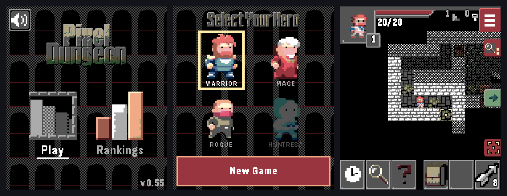

# Pixel Dungeon for Pebble

A faithful port of **[Pixel Dungeon](https://github.com/watabou/pixel-dungeon) 1.9.1** by Watabou to Pebble smartwatches, written in C for PebbleOS. It plays the full original game on a 200×228 colour screen, using only the watch's four buttons.



The repository also holds the **dungeon bot**: a program that plays the real game code on a PC, thousands of games at a time. It is used to test the port, and it powers the watch's built-in move suggestions.

## Features

- **The whole game.** It has all 26 floors, four hero classes with their subclasses, every monster and boss, the quests, shops, alchemy, enchantments, the Amulet and the ending. The rules, numbers, level generator and texts come from the original source.
- **Playable with buttons alone.** Up/Down step through suggested targets, Select acts, and Back moves across the toolbar. On watches with a touch screen, touch works as a backup.
- **Move suggestions (Assist).** The watch suggests moves using the same targeting logic as the bot. Low suggests where to attack, explore and pick up; Medium also suggests where to step; High also suggests toolbar and item use. Change it in the game menu (long-press Up).
- **Original look and sound.** Watabou's sprites are converted to the Pebble palette, and the original soundtrack and effects are re-created for the watch speaker.
- **Permanent death.** The game saves itself at every step, so there is no reloading after a death, just like the original.
- **Fits in 64 KB.** The app image stays under Pebble's 64 KB code limit. The rest of the game lives in 27 code overlays that are loaded from resources when needed (see [docs/ARCHITECTURE.md](docs/ARCHITECTURE.md)).

**Platforms:** Pebble Time 2 (`emery`) is the main target. Pebble Round 2 (`gabbro`) builds and runs, but its round-screen layout is still basic.

## Repository layout

| Folder | What's in it |
|---|---|
| [`watch/`](watch) | The Pebble app: C sources, overlays, art, sound and text resources, and the build tools. |
| [`bot/`](bot) | The dungeon bot and host tests. They compile the watch's game code for Linux and play it headless. |
| [`bot/runner/`](bot/runner) | A job runner that spreads bot games across every core of a Windows PC (via WSL). |
| [`tools/javapd/`](tools/javapd) | The original Java game, made to run headless, for comparing the C port against the original. |
| [`scripts/`](scripts) | Release packaging, the "What-If" test build, and emulator helpers. |
| [`docs/`](docs) | Building, architecture, the bot, and development notes. |
| `third_party/` | Watabou's `pixel-dungeon` and `pd-classes` as git submodules, used as the reference source and for the art. |

## Quick start

Clone with the submodules:

```sh
git clone --recursive https://github.com/TomBolger/PixelDungeon-.git
cd PixelDungeon-
```

**Build the watch app.** This needs the Pebble SDK; on Windows, use WSL. See [docs/BUILDING.md](docs/BUILDING.md).

```sh
cd watch && ./tools/build.sh          # -> watch/build/watch.pbw
pebble install --phone <phone-ip> build/watch.pbw
```

**Build and run the bot.** This needs only gcc and Python 3.

```sh
bot/build.sh                          # -> bot/build/deepbot
cd bot && ./score.sh 20               # 20 games under normal rules, with a summary
```

## Documentation

- [docs/BUILDING.md](docs/BUILDING.md): setting up the SDK, building, installing on a watch or the emulator, and making releases.
- [docs/ARCHITECTURE.md](docs/ARCHITECTURE.md): how the game fits on a watch (memory budget, overlays, resources, saving) and a map of the code.
- [docs/BOT.md](docs/BOT.md): the dungeon bot, its settings, the test checks it runs, and the PC runner.
- [CONTRIBUTING.md](CONTRIBUTING.md): how to make and test changes.

## Project status

- **Version 0.55.** The whole game is ported and is tested on a real Pebble Time 2.
- **Current work:** finishing the Gabbro (round-screen) layout and teaching the bot to win. It reaches floor 5–6 on average and has not won a normal-rules game yet.
- **Help wanted:** strategy ideas for the bot, especially from experienced players.

## Credits and license

- **Pixel Dungeon:** © 2012–2015 Oleg Dolya (Watabou), released under the GNU GPL v3. The game rules, texts, art and music in this port are derived from it.
- **This port:** © 2026 Thomas Bolger. It is also released under the **GNU General Public License v3**; see [LICENSE](LICENSE).

This is a fan project and is not affiliated with Watabou.
