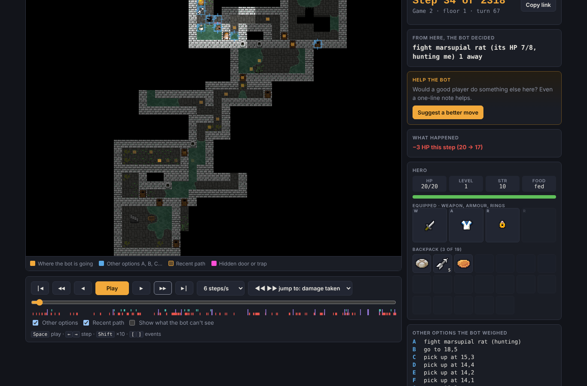

# Replay site

A public web page for stepping through the bot's games move by move and sending feedback on any moment ("a good player would retreat here"). Feedback is saved with the exact game and step, so it can be replayed and turned into bot rules.



## Parts

| Path | What it is |
|---|---|
| `www/index.html` | The whole viewer: one HTML file with no build step. It loads `assets.json` and `games/index.json`, then one game file at a time. |
| `www/assets.json` | Pixel Dungeon art as data URIs: tiles, water, items, plants, heroes, monsters. Rebuild with `tools/assets.py`. |
| `www/games/` | Recorded games (not committed, because they are large). Make them with `tools/record_games.sh`. |
| `server.py` | The feedback API, using only the Python standard library. |
| `Caddyfile.template`, `setup.sh` | Web server config (with automatic HTTPS) and a one-command install for Ubuntu. |
| `DEPLOY.txt` | Plain-language deployment steps (DigitalOcean + DuckDNS), shipped as the bundle's README. |
| `tools/` | `record_games.sh`, `make_index.py`, `pack.py`, `assets.py`, `package_site.sh` |

## Viewer features

- **Game picker:** filter by class and sort by floor reached.
- **Transport controls:** play, step, jump to the next damage, floor change, fight or item use, and a timeline with event ticks.
- **Panels:** the bot's decision and reason, the game log, hero stats, equipment and backpack (with item descriptions), and the other options the bot weighed.
- **Show what the bot can't see:** an option that reveals the whole floor, including hidden doors and traps.
- **Deep links:** `#g13/450` opens game 13 at step 450. **Copy link** makes one.
- **Feedback form:** a category, free text, a scope (this step, the last few, the whole game) and an optional name. Spam protection is a hidden robot trap field and a limit of 30 notes per visitor per hour. Visitor addresses are stored only as a salted hash.

## Record games

```sh
tools/record_games.sh 48 0 "Oct 13"     # games 0-47, normal rules, labelled "Oct 13"
```

This builds the bot, plays the games in parallel with `REC=`, and packs each into `www/games/gN.json`. Each file is 0.3–3 MB; the web server compresses them about 25×. It also writes `www/games/index.json`.

## Run locally

```sh
PEBXEL_DATA=/tmp/pebxel-data python3 server.py     # feedback API on 127.0.0.1:8080
```

The page and the API must share one origin. Either run Caddy with a local config (`http://localhost:8088`, serving `www/` and proxying `/api/*` to port 8080), or just open `www/` with `python3 -m http.server` to browse games without feedback.

## Feedback API

| Request | Result |
|---|---|
| `POST /api/feedback` | A JSON note: `game`, `frame`, `step`, `turn`, `depth`, `did`, `cat`, `scope`, `text`, `name`. It is appended to `data/feedback.jsonl`. |
| `GET /api/feedback?key=KEY` | All notes as an HTML table, with links straight to each moment |
| `GET /api/feedback?key=KEY&format=jsonl` | The raw file |
| `GET /api/health` | `ok` |

The admin key is created on first start in `data/admin_key.txt`. Valid categories are `bad-move`, `run`, `fight`, `item`, `waste`, `explore`, `gear` and `other`.

## Deploy

```sh
tools/package_site.sh            # -> dist/pebxel-site.tgz
```

Then follow `DEPLOY.txt`: create a $4 Ubuntu droplet, point a free DuckDNS name at it, upload the bundle, and run `bash pebxel-site/setup.sh yourname.duckdns.org`. The setup script:

- installs Caddy, which gets the HTTPS certificate automatically;
- serves pre-compressed game files;
- runs `server.py` as a locked-down systemd service;
- turns on the firewall;
- prints the private feedback link.

Running it again updates the site and keeps the notes collected so far.
